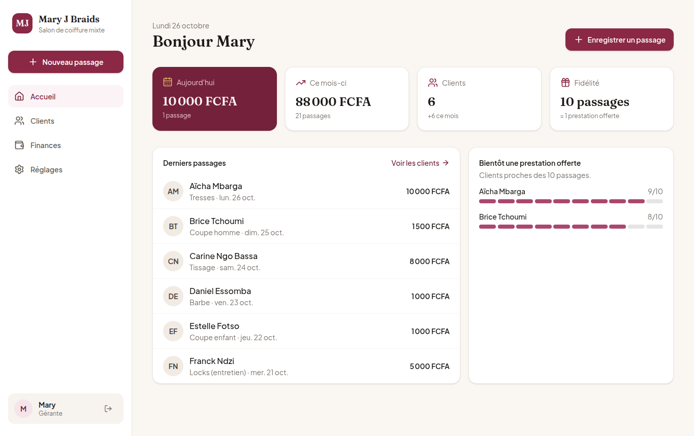
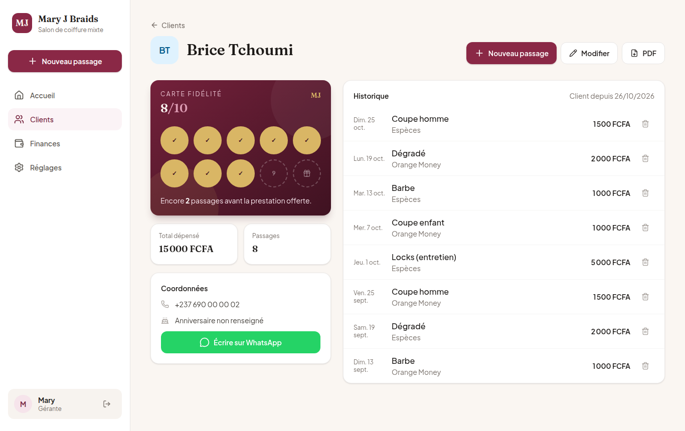
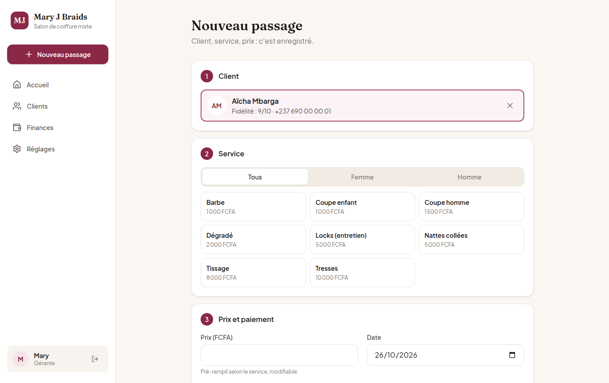
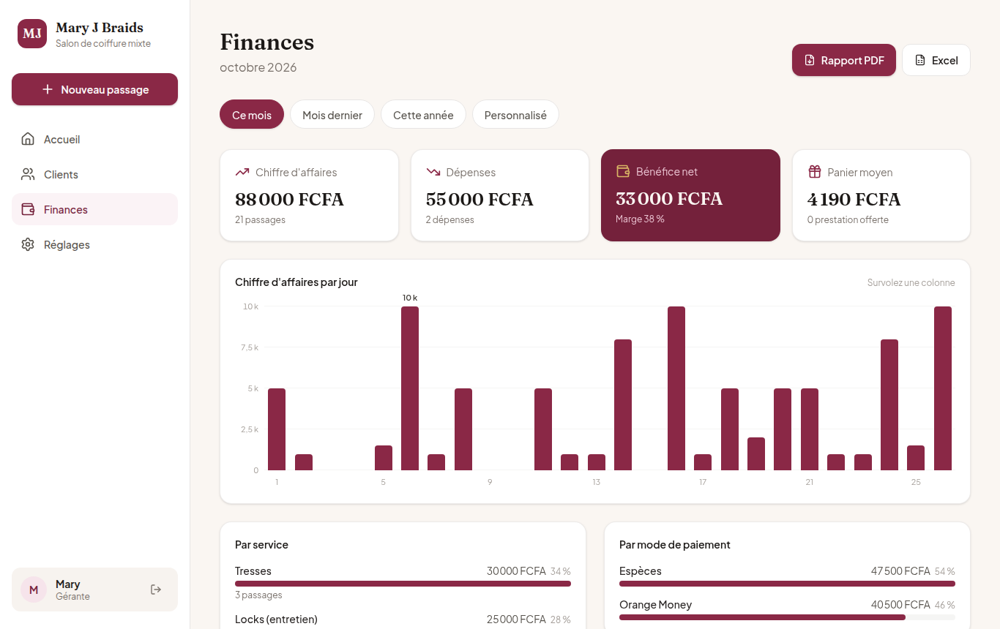

# Mary J Braids — Gestion du salon

Application web de gestion pour **Mary J Braids**, salon de coiffure mixte (hommes et femmes) :
clients, prestations, programme de fidélité et finances, depuis un téléphone ou un ordinateur.

   

## Aperçu

| Accueil                                               | Fiche client et fidélité                        |
| ----------------------------------------------------- | ----------------------------------------------- |
|                  |  |
| **Nouveau passage**                                   | **Finances**                                    |
|  |          |


> Captures réalisées avec des données de démonstration fictives.

## Fonctionnalités

| Module                 | Ce qu'il permet                                                                                                                                                                                                                             |
| ---------------------- | ------------------------------------------------------------------------------------------------------------------------------------------------------------------------------------------------------------------------------------------- |
| **Connexion et rôles** | Accès par identifiant et mot de passe (session chiffrée, 7 jours). Rôle **gérant** (accès complet) ou **employé** (clients et passages, sans finances ni réglages).                                                                         |
| **Accueil**            | Chiffre du jour et du mois, derniers passages, clients proches d'une prestation offerte.                                                                                                                                                    |
| **Clients**            | Liste avec recherche instantanée, fiche client, historique, carte de fidélité, message WhatsApp pré-rempli, fiche PDF.                                                                                                                      |
| **Passages**           | Client existant ou créé à la volée, catalogue hommes / femmes ou **service saisi librement** (ajouté au catalogue), prix pré-rempli, Espèces / Orange Money / MTN MoMo. Modification et suppression depuis la fiche client ou les finances. |
| **Fidélité**           | Une case par passage payé ; au seuil (10 par défaut), la prestation suivante est offerte et la carte repart à zéro.                                                                                                                         |
| **Finances**           | Périodes (mois, mois dernier, année, personnalisée), chiffre d'affaires, dépenses (ajout, modification, suppression), bénéfice net, graphique, répartitions, meilleurs clients, liste des passages modifiables.                             |
| **Exports**            | Rapport financier PDF, fiche client PDF, export Excel (CSV) des passages.                                                                                                                                                                   |
| **Réglages**           | Catalogue des services (ajout, modification, masquage, suppression si jamais utilisé), seuil de fidélité, **utilisateurs** (création, rôle, réinitialisation du mot de passe, suppression), mot de passe personnel.                         |

Interface pensée d'abord pour le téléphone (barre de navigation en bas, gros boutons),
animations discrètes qui respectent le réglage « réduire les animations » du système.

## Stack technique

- **[Next.js 16](https://nextjs.org)** (App Router, Server Actions, Turbopack) et **React 19**
- **TypeScript** strict, **Tailwind CSS 4**, icônes **Lucide**
- **MySQL 8** via **[Drizzle ORM](https://orm.drizzle.team)** (migrations versionnées dans `drizzle/`)
- **iron-session** (cookie chiffré) et **bcrypt** pour l'authentification
- **Zod** pour la validation des formulaires côté serveur
- **@react-pdf/renderer** pour les documents PDF

## Démarrage en local

Prérequis : Node.js 20.9 ou plus, Docker.

```bash
npm install
cp .env.example .env            # puis renseigner SESSION_PASSWORD (openssl rand -base64 32)
docker compose up -d --wait     # MySQL local sur le port 3307
npm run db:migrate              # crée les tables
npm run db:seed                 # compte gérant + catalogue de services
npm run db:seed:demo            # (facultatif) clients et passages fictifs
npm run dev                     # http://localhost:3000
```

Identifiants : ceux de `ADMIN_USERNAME` / `ADMIN_PASSWORD` dans `.env`.

## Scripts

| Commande                                                      | Rôle                                                          |
| ------------------------------------------------------------- | ------------------------------------------------------------- |
| `npm run dev`                                                 | Serveur de développement                                      |
| `npm run build` / `npm start`                                 | Build et serveur de production                                |
| `npm run lint` · `npm run typecheck` · `npm run format:check` | Qualité du code (lancés aussi par la CI)                      |
| `npm run db:generate`                                         | Génère une migration après modification de `src/db/schema.ts` |
| `npm run db:migrate`                                          | Applique les migrations                                       |
| `npm run db:seed`                                             | Crée / met à jour le compte gérant et le catalogue            |
| `npm run db:studio`                                           | Explorateur de base de données Drizzle Studio                 |

## Structure

```
src/
├── app/
│   ├── login/                 Connexion (page, formulaire, actions)
│   └── (app)/                 Espace protégé : menu, animations de page, chargement
│       ├── page.tsx           Accueil
│       ├── clients/           Liste, fiche, création, modification, fiche PDF
│       ├── passages/nouveau/  Formulaire de passage
│       ├── finances/          Tableau financier, dépenses, exports PDF et Excel
│       └── reglages/          Services, fidélité, mot de passe
├── components/                Interface (ui/ = briques de base, finances/ = graphiques)
├── db/                        Schéma Drizzle et connexion MySQL
├── lib/                       Session, authentification, fidélité, requêtes, PDF, formats
└── proxy.ts                   Redirection vers /login sans session
scripts/                       Initialisation de la base (seed)
drizzle/                       Migrations SQL
```

## Sécurité

- Chaque page, action et export vérifie la session côté serveur (`requireUser`, `requireAdmin` pour les finances et les réglages), pas seulement le proxy.
- Un gérant ne peut ni se rétrograder ni supprimer son propre compte ; il reste toujours au moins un gérant.
- Mots de passe hachés avec bcrypt (12 tours) ; cookie de session `httpOnly`, `secure` en production.
- Toutes les saisies sont validées côté serveur avec Zod ; les requêtes SQL passent par Drizzle (paramétrées).
- Aucune donnée réelle dans ce dépôt : `.env` est ignoré par git, les données de démo sont fictives.

## Déploiement

Hébergement prévu : **Hostinger** (Node.js + MySQL). Voir [docs/deploiement-hostinger.md](docs/deploiement-hostinger.md).

---

Conçu et développé par **Rykiel Kameni**, Software Engineer. © 2026 Mary J Braids — tous droits réservés.
